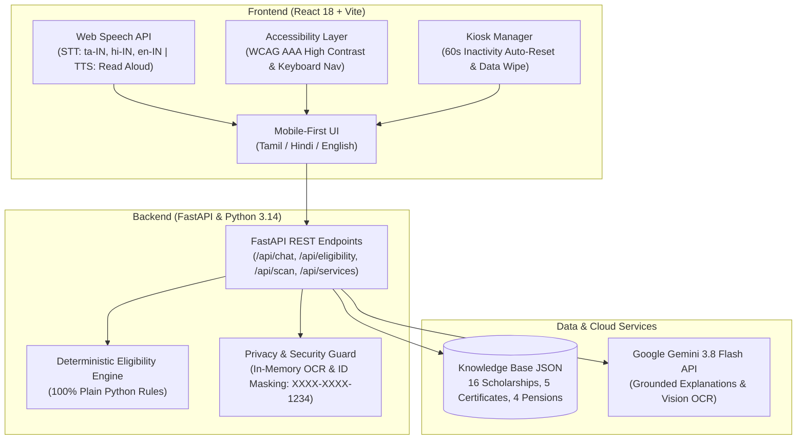
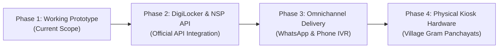

# 🏛️ Jan Sahayak (மக்கள் உதவியாளர் / जन सहायक)
### Voice-First AI Citizen Scheme, Certificate & Pension Assistant

[](https://opensource.org/licenses/MIT)
[](https://www.python.org/)
[](https://react.dev/)
[](https://ai.google.dev/)
[](https://www.w3.org/WAI/standards-guidelines/wcag/)

> **Jan Sahayak** is a voice-first, multilingual AI assistant built to bridge India's digital and literacy divide. It helps rural citizens, senior citizens, first-generation students, and visually impaired individuals discover and navigate government scholarships, social welfare pensions, and citizen revenue certificates in **Tamil (`ta-IN`)**, **Hindi (`hi-IN`)**, and **English (`en-IN`)**.

---

## 🌟 Key Features

1. **Voice-First Interaction (Web Speech API)**:
   - Real-time speech recognition (STT) and speech synthesis (TTS) in Tamil, Hindi, and English with auto read-aloud and device voice detection.
2. **Deterministic, Auditable Eligibility Engine**:
   - 100% plain Python rule evaluation (zero hallucination). Evaluates age limits, income caps, categories, gender, and school history to return `eligible`, `maybe`, or `not_eligible` with human-readable legal reasons.
3. **Grounded AI Answers (Google Gemini 3.8 Flash)**:
   - Grounded strictly in our verified government database. Always includes official application URLs and verification dates.
4. **Guided 7-Question Scholarship Finder**:
   - A step-by-step, one-question-at-a-time flow that speaks each question aloud and accepts touch or voice answers.
5. **Interactive Document Checklist**:
   - Dynamic progress tracker where citizens check off documents they have (Aadhaar, Marksheets, Ration Card), with audio summaries of remaining requirements.
6. **Privacy-Preserving Document Scanner**:
   - Gemini Vision OCR with mandatory explicit privacy consent. Processes images strictly in RAM and discards them immediately.
   - Automatically masks all ID digits except the last 4 (e.g. `XXXX-XXXX-8921`).
7. **Accessibility Mode (WCAG AAA)**:
   - Instant high-contrast theme (Pure Black `#000000` with Bright Yellow `#FFFF00` and Cyan `#00FFFF`), 1.35x enlarged text, visible 4px focus rings, and full keyboard navigation.
8. **Kiosk Demo Mode (`?kiosk=1`)**:
   - Fullscreen-style layout with giant touch buttons and an automatic **60-second inactivity auto-reset timer** that wipes session data when a citizen walks away.
9. **"Talk to a Human" Fallback**:
   - Direct helpline directory (TN CM Helpline 1100, Elderline 14567, Women Helpline 181, e-Sevai 1800-425-1333) and Common Service Centre (CSC) locator.

---

## 🏗️ System Architecture



---

## 🚀 How to Run Locally

### Prerequisites
- **Python 3.10+** (tested on Python 3.14)
- **Node.js 18+** (with npm)
- **Git**
- A free Gemini API key from [Google AI Studio](https://aistudio.google.com/app/apikey)

---

### Step 1: Clone the Repository
```bash
git clone https://github.com/YOUR_USERNAME/jan-sahayak.git
cd jan-sahayak
```

---

### Step 2: Set Up Backend
1. Create a Python virtual environment:
   ```powershell
   python -m venv backend\.venv
   backend\.venv\Scripts\activate
   ```
2. Install Python dependencies:
   ```powershell
   pip install -r backend\requirements.txt
   ```
3. Set up your Gemini API key:
   - Double-click **`setup_key.bat`** (automated helper), OR
   - Copy `backend\.env.example` to `backend\.env` and paste your key:
     ```env
     GEMINI_API_KEY=your_actual_key_here
     GEMINI_MODEL=gemini-3.8-flash
     ALLOWED_ORIGINS=http://localhost:5173,http://127.0.0.1:5173
     PORT=8005
     ```
4. Run the automated test suite:
   ```powershell
   pytest backend\tests\
   ```
5. Start the backend server:
   ```powershell
   cd backend
   uvicorn app.main:app --reload --port 8005
   ```
   Backend will be live at: `http://localhost:8005/api/health`

---

### Step 3: Set Up Frontend
1. Open a new terminal and navigate to `frontend`:
   ```powershell
   cd frontend
   npm install
   ```
2. Start the Vite dev server:
   ```powershell
   npm run dev
   ```
3. Open **[http://localhost:5173](http://localhost:5173)** in Google Chrome!
   *(For Kiosk Mode, open [http://localhost:5173/?kiosk=1](http://localhost:5173/?kiosk=1))*.

---

## ☁️ How to Deploy

### 1. Backend on Render (Free Web Service)
1. Go to [Render Dashboard](https://dashboard.render.com/) ➔ **New +** ➔ **Web Service**.
2. Connect your GitHub repository.
3. Configure:
   - **Root Directory**: `backend`
   - **Runtime**: `Python 3`
   - **Build Command**: `pip install -r requirements.txt`
   - **Start Command**: `uvicorn app.main:app --host 0.0.0.0 --port $PORT`
4. Add Environment Variables:
   - `GEMINI_API_KEY`: *(your Gemini key)*
   - `GEMINI_MODEL`: `gemini-3.8-flash`
   - `ALLOWED_ORIGINS`: `https://*.vercel.app,http://localhost:5173`
5. Copy your live Render URL (e.g. `https://jan-sahayak-backend.onrender.com`).

### 2. Frontend on Vercel
1. Go to [Vercel](https://vercel.com/) ➔ **Add New...** ➔ **Project**.
2. Import your GitHub repository.
3. Configure:
   - **Root Directory**: `frontend`
   - **Build Command**: `npm run build`
   - **Output Directory**: `dist`
4. Add Environment Variable:
   - `VITE_API_BASE_URL`: `https://jan-sahayak-backend.onrender.com`
5. Click **Deploy**!

> [!NOTE]
> Free cloud servers sleep after 15 minutes of inactivity. The first request after sleep takes 30-40 seconds to spin up. Jan Sahayak displays an automatic waking-up message in the UI so users are kept informed!

---

## 🛠️ How to Extend Jan Sahayak

### 1. Adding a New Government Scheme
Open `data/scholarships.json` (or `data/pensions.json` or `data/certificates.json`) and append an entry:
```json
{
  "id": "new-scheme-id",
  "name": "Scheme Name",
  "level": "central",
  "state": "All",
  "short_description": "Plain language explanation",
  "benefits": "₹15,000 per year",
  "eligibility_rules": {
    "min_age": 16,
    "max_age": 28,
    "max_family_income": 300000,
    "allowed_categories": ["SC", "ST", "OBC"],
    "gender": "any",
    "requires_disability": false,
    "education_levels": ["Undergraduate"]
  },
  "required_documents": ["Aadhaar Card", "Income Certificate"],
  "how_to_apply": "Apply via official portal",
  "deadline": "Check portal",
  "source_url": "https://official.gov.in",
  "last_verified": "2026-10-29",
  "status": "verified"
}
```
*The deterministic eligibility engine automatically evaluates it immediately with zero code changes.*

### 2. Adding a New Language (e.g., Telugu, Kannada)
Open `frontend/src/i18n.js`:
1. Add an entry to the `LANGUAGES` array:
   ```javascript
   { code: 'te', label: 'తెలుగు', name: 'Telugu', speechCode: 'te-IN', greeting: 'నమస్కారం! నేను జన సహాయక్...' }
   ```
2. Add translation strings for UI labels under `TRANSLATIONS.te`.

### 3. Adding a New State
In any scheme's `"state"` field, specify the state name (e.g. `"Karnataka"` or `"Maharashtra"`). The eligibility engine automatically enforces state residence checks.

---

## ⚠️ Known Limitations of this Prototype

1. **Speech Recognition Browser Support**: The Web Speech API works natively in Chromium browsers (Google Chrome, Microsoft Edge, Brave). On Safari or Firefox, voice input falls back to text typing.
2. **Device TTS Language Packs**: Text-to-speech output depends on whether the user's OS has Tamil/Hindi speech synthesizers installed. If missing, Jan Sahayak surfaces a diagnostic banner and text displays normally.
3. **Simulated Document Uploads**: For security, this prototype uses sample/dummy documents and masks all identification numbers. Real Aadhaar biometric authentication is excluded from this scope.

---

## 🗺️ Roadmap to Full Production Product



1. **National Portals & DigiLocker Integration**:
   - Official OAuth integration with **DigiLocker** to pull verified caste, income, and marksheet credentials directly with citizen biometric consent.
   - Two-way API integration with the **National Scholarship Portal (NSP)** and Tamil Nadu **e-Sevai (TNeGA)** for direct application status tracking.
2. **All 22 Scheduled Indian Languages**:
   - Expand AI grounding and voice synthesis across all 22 official Indian languages using open Indic models (e.g. AI4Bharat / Bhashini).
3. **Omnichannel Access (WhatsApp Voice Bot & IVR)**:
   - Voice-based WhatsApp chatbot and a toll-free `1800` telephone hotline for citizens without smartphones.
4. **Physical Panchayat Kiosk Hardware**:
   - Standalone rugged kiosks for Village Administrative Offices (VAO) and Gram Panchayats equipped with thermal printers and biometric fingerprint scanners.

---

## 📄 Documentation Links
* [3-Minute Hackathon Demo Script](file:///d:/AntiGravity/docs/DEMO_SCRIPT.md)
* [System Architecture Deep-Dive](file:///d:/AntiGravity/docs/ARCHITECTURE.md)
* [End-to-End Testing Checklist](file:///d:/AntiGravity/docs/TESTING_CHECKLIST.md)
* [Implementation Plan Roadmap](file:///d:/AntiGravity/docs/IMPLEMENTATION_PLAN.md)
* [Original Project Brief](file:///d:/AntiGravity/PROJECT_BRIEF.md)

---

## ⚖️ License
Distributed under the MIT License. Built with ❤️ for Indian citizens.
